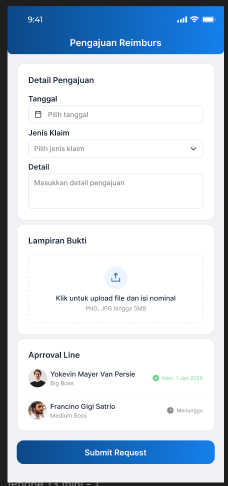
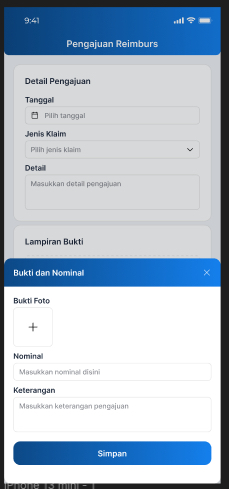
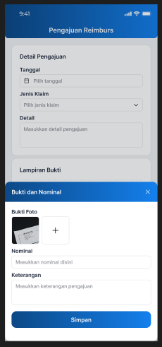
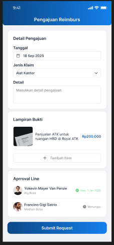

<p align="center">
  
</p>

<h1 align="center">Reimburse Venturo</h1>

<p align="center">
  <b>Ajukan reimburse tanpa ribet: isi form, lampirkan bukti, pantau approval.</b><br>
  Flutter · Clean Architecture · GetX
</p>

<p align="center">
  <a href="https://flutter.dev"></a>
  <a href="https://pub.dev/packages/get"></a>
  
</p>

---

## ✨ Preview

<p align="center">
  
</p>

<table align="center">
  <tr>
    <td></td>
    <td></td>
    <td></td>
    <td></td>
  </tr>
  <tr>
    <td align="center">Form pengajuan</td>
    <td align="center">Detail</td>
    <td align="center">Upload bukti</td>
    <td align="center">Approval</td>
  </tr>
</table>

---

## 📖 Tentang

Aplikasi manajemen reimburse karyawan. Pengguna membuat pengajuan lengkap dengan tanggal,
jenis klaim, nominal Rupiah, detail, dan lampiran (gambar, PDF, Excel, Word), lalu melihat
status persetujuan sesuai alur approval.

---

## 🌟 Fitur

- 📋 **Daftar kategori reimburse**
- 📝 **Form pengajuan** — date picker kalender, dropdown 8 jenis klaim, text area detail
- 💰 **Input nominal** dengan format Rupiah
- 📎 **Upload multi-file** — gambar, PDF, Excel, Word, dengan preview
- 🧾 **Approval line** — hierarki persetujuan beserta status
- ✅ **Validasi form** sebelum submit

---

## 🛠️ Tech Stack

| Area | Pilihan |
|---|---|
| Framework | Flutter 3.9+, Dart 3 |
| State management | GetX 4.6 |
| UI | Google Fonts, Table Calendar, Dotted Border |
| File | `image_picker`, `file_picker` |
| Format | `intl` (Rupiah & tanggal) |

---

## 🏗️ Arsitektur

Clean Architecture tiga lapis:

```text
lib/app/
├── data/        # Model & repository implementation
├── domain/      # Entity & use case
└── presentation/# UI, controller GetX
```

---

## 🚀 Menjalankan

```bash
flutter pub get
flutter run
```

---

## 🧪 Testing

```bash
flutter analyze
flutter test
```
